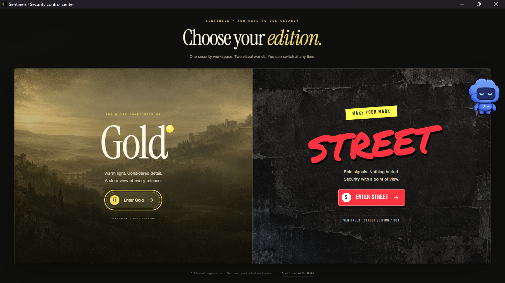

# SentinelX Desktop

A native Windows desktop window around your existing SentinelX website. The same
FastAPI application, the same PostgreSQL data, the same Gold/Street interface —
just launched like a desktop program instead of a browser tab.



**The `SentinelX` folder is never modified.** The desktop shell only reads it,
starts the same server on `127.0.0.1` and displays it in a WebView2 window.

## Start it

Double-click **`Start SentinelX Desktop.cmd`** (or the **SentinelX Desktop**
shortcut created on your Desktop and in the Start Menu).

- First launch only: it builds an isolated runtime in `runtime\` and downloads
  the website's own pinned dependencies plus the native window engine. This
  needs an internet connection once.
- Every launch after that works offline.
- Docker Desktop must be running, because the website stores its data in
  PostgreSQL in Docker. If the database is already running, it is reused.

## What is identical

| Website | Desktop app |
| --- | --- |
| `/` dashboard, Gold and Street editions | same, unchanged |
| `/admin` administrator portal | same, unchanged |
| API under `/api/v1` | same process, same behaviour |
| PostgreSQL database | same database, same accounts, projects, scans |
| Session cookies, 8-hour lifetime | same |
| Uploads up to 20 MiB, scanning, reports | same |

Only the window is new. No HTML, CSS, JavaScript or Python file of the website
was edited, and the checkout is verified unchanged after every test run.

## Where things live

- App: this folder (`SentinelX Desktop`).
- Website: `..\SentinelX`.
- Runtime: `runtime\.venv` (isolated; your project's `.venv` is untouched).
- Logs: `%LOCALAPPDATA%\SentinelX Desktop\logs\desktop.log` and `backend.log`.
- Window storage: `%LOCALAPPDATA%\SentinelX Desktop\window` (keeps your
  Gold/Street choice and session between launches).

## Troubleshooting

**"PostgreSQL could not be started"** — open Docker Desktop, wait until it says
it is running, then open the app again. The database is `sentinelx-postgres`,
the same one the website uses.

**A console appears and closes** — run `Start SentinelX Desktop.cmd` from a
terminal to read the message; the log files above also record it.

**The window is blank** — check `backend.log`. If a port is already in use, the
app picks the next free port automatically.

**Repair the runtime** — delete the `runtime` folder and run
`Start SentinelX Desktop.cmd` again.

**Uninstall** — delete this folder, then remove
`%LOCALAPPDATA%\SentinelX Desktop` and the two shortcuts. Your database and the
`SentinelX` project stay as they are.

## Command line

```bat
runtime\.venv\Scripts\python.exe "SentinelX Desktop.pyw"              :: normal start
runtime\.venv\Scripts\python.exe -m desktop.main --self-test         :: headless check
runtime\.venv\Scripts\python.exe -m desktop.main --port 8123         :: preferred port
```

Set `SENTINELX_PROJECT_DIR` to point at a SentinelX checkout elsewhere, and
`DATABASE_URL` to use a different PostgreSQL server.
